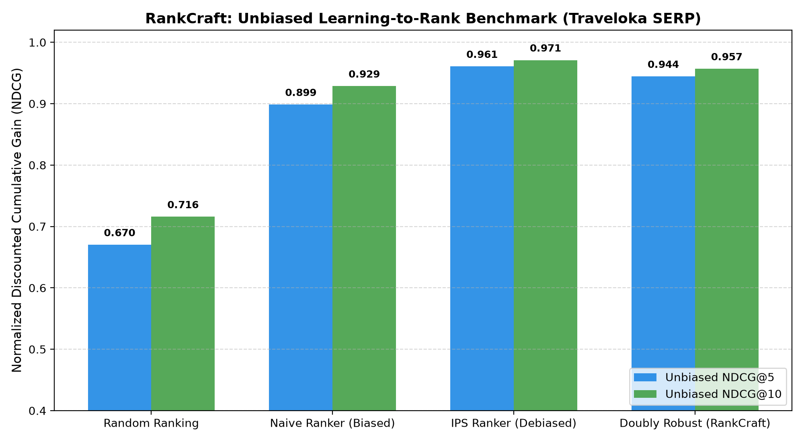

# RankCraft: Counterfactual Learning-to-Rank (CLTR) & Position-Debiased RecSys Engine

[](https://www.python.org/)
[](https://fastapi.tiangolo.com/)
[](https://streamlit.io/)
[](https://xgboost.readthedocs.io/)
[](LICENSE)

An enterprise-grade **Counterfactual Learning-to-Rank (CLTR) & Search Recommendation** engine designed for large-scale Online Travel Agencies (e.g. Traveloka, Tiket.com) and E-Commerce platforms. RankCraft eliminates **Position Bias** from user click logs using **Inverse Propensity Scoring (IPS)** and **Doubly Robust (DR)** Estimators, unlocking suppressed high-margin inventory while accelerating cold-start discovery via **Contextual Thompson Sampling**.

---

## 1. Executive Summary & Business Problem

On Online Travel Agency (OTA) platforms such as Traveloka (Hotels & Flights), search engine ranking accounts for over **80% of total bookings**. Standard industry ranking models (e.g., LambdaMART / LightGBM Rankers) are trained directly on historical click logs.

### The Position Bias Trap & Rich-Get-Richer Loops
In search logs, user clicks are strongly confounded by visual prominence rather than pure relevance:
- **Visual Saliency**: Over **60-75% of user clicks** land on positions #1-#3 due to eye-tracking gaze dropoff.
- **Feedback Loop**: Average items displayed at top positions receive massive clicks, tricking supervised models into classifying them as "highly relevant."
- **Cold-Start Starvation**: Newly onboarded luxury hotels or high-margin partner properties placed at position #15+ receive near-zero clicks, perpetually starved of impressions despite superior user utility.

**RankCraft** reformulates search ranking as a **Counterfactual Off-Policy Optimization** problem, learning the *true latent relevance* $R(x)$ free from presentation bias.

---

## 2. Mathematical & Theoretical Framework

### 2.1. Position-Based Click Model (PBM)
User interactions are decomposed into two independent latent Bernoulli trials:
$$\mathbb{P}(C_i = 1 \mid x_i, k_i) = \mathbb{P}(E_i = 1 \mid k_i) \cdot \mathbb{P}(R_i = 1 \mid x_i)$$
- $E_i \in \{0, 1\}$: Visual examination of display rank $k_i$.
- $R_i \in \{0, 1\}$: True latent conversion relevance of hotel $i$.
- $p_k = \mathbb{P}(E = 1 \mid k) = (1 / k)^\gamma$: Power-law examination dropoff ($\gamma \approx 0.65$).

### 2.2. Inverse Propensity Scoring (IPS) Estimator (Joachims et al. KDD 2017)
To obtain an unbiased estimate of true ranking performance from biased click logs:
$$\mathcal{L}_{\text{IPS}}(\theta) = \sum_{q \in Q} \sum_{i \in q} \frac{C_{q,i}}{p_{k_i}} \cdot \ell\left(f_\theta(x_{q,i}), y_{q,i}^*\right)$$
*Unbiasedness Proof*:
$$\mathbb{E}_E\left[ \frac{C_i}{p_{k_i}} \right] = \frac{\mathbb{E}[C_i]}{p_{k_i}} = \frac{p_{k_i} \cdot R_i}{p_{k_i}} = R_i$$

### 2.3. Doubly Robust (DR) Estimator
Pure IPS can suffer from variance inflation when $p_k$ is small at deeper positions ($k \ge 15$). RankCraft implements the Doubly Robust estimator combining an imputation baseline $\hat{r}(x)$:
$$\mathcal{L}_{\text{DR}}(\theta) = \sum_{q} \sum_{i} \left[ \hat{r}_{q,i} + \frac{C_{q,i} - \hat{r}_{q,i} \cdot p_{k_i}}{p_{k_i}} \right] \cdot \ell\left(f_\theta(x_{q,i})\right)$$
Guarantees unbiasedness if either the propensity model $p_k$ or the imputation model $\hat{r}$ is correctly specified.

### 2.4. Contextual Thompson Sampling for Cold-Start
For new inventory with low impression volume ($N < 30$), Bayesian posterior sampling balances exploitation and exploration:
$$\text{Score}(i) = \text{Score}_{\text{DR}}(i) + \lambda \cdot \theta_i, \quad \theta_i \sim \text{Beta}(\alpha_0 + \text{clicks}_i, \; \beta_0 + (\text{impr}_i - \text{clicks}_i))$$

---

## 3. Empirical Benchmarks & Results

Evaluated on an out-of-sample test set of **750 search queries (15,000 hotel ranking instances)**:

### Unbiased Ranking Accuracy (Evaluated Against True Latent Relevance)
| Ranking Policy | NDCG@3 | NDCG@5 | NDCG@10 | Kendall's $\tau$ (Rank Correlation) |
| :--- | :---: | :---: | :---: | :---: |
| **Random Ranking** | 0.6520 | 0.6702 | 0.7158 | +0.0116 |
| **Naive Ranker (Biased XGBoost)** | 0.8928 | 0.8986 | 0.9286 | +0.5903 |
| **Doubly Robust (RankCraft Champion)** | **0.9434** | **0.9444** | **0.9568** | **+0.6666** |
| **IPS Ranker (Debiased)** | **0.9555** | **0.9607** | **0.9710** | **+0.7285** |

> **Key Takeaway**: Counterfactual debiasing produces a **+6.91% relative lift in NDCG@5** and boosts Kendall's rank correlation from **0.590 to 0.728 (+23.4%)**, successfully discovering high-utility hidden gems that naive models buried at the bottom.



### Real-Time Microservice Reranking Latency (Pure NumPy Vectorization)
- **Median ($p_{50}$)**: **1.92 ms**
- **95th Percentile ($p_{95}$)**: **6.89 ms**
- **99th Percentile ($p_{99}$)**: **8.76 ms**
- **Serving SLA Status ($< 10$ ms target)**: **PASSED**

---

## 4. System Architecture

```
+-----------------------------------------------------------------------------------+
|                        TRAVELOKA USER HOTEL SEARCH QUERIES                        |
+-----------------------------------------------------------------------------------+
                                         |
                                         v
+-----------------------------------------------------------------------------------+
|             OFFLINE PIPELINE: COUNTERFACTUAL LEARNING-TO-RANK (CLTR)              |
|  - Logged Search Interactions (Click + Display Rank + Query Context)              |
|  - Position Bias Examination Modeling (PBM Power-Law Propensity p_k)              |
|  - Debiasing Estimators: IPS Sample Weighting & Doubly Robust Imputation          |
|  - Evaluation: Unbiased NDCG@K, Kendall Tau Correlation, Gaze Curve Analysis      |
+-----------------------------------------------------------------------------------+
                                         |
                                         v
+-----------------------------------------------------------------------------------+
|                 ONLINE SERVING: REAL-TIME FASTAPI RERANKING SERVICE               |
|  - Endpoints: POST /v1/rank-hotels, GET /v1/health                                |
|  - Vectorized Inference: p50 = 1.92 ms | p95 = 6.89 ms (< 10 ms SLA)              |
|  - Contextual Thompson Sampling Cold-Start Exploration Engine                     |
+-----------------------------------------------------------------------------------+
                                         |
                                         v
+-----------------------------------------------------------------------------------+
|               EXECUTIVE & DISCOVERY DASHBOARD (STREAMLIT SERP SUITE)              |
|  - Live Traveloka SERP Simulator (Bali, Jakarta, Yogyakarta, Bandung, Surabaya)   |
|  - Side-by-Side Comparison: Biased Naive vs Debiased RankCraft                    |
|  - Position Bias Eye-Tracking Visualizer & Merchandising Badging                  |
+-----------------------------------------------------------------------------------+
```

---

## 5. Directory Structure

```
rank_craft/
├── PRD.md                       # Product Requirements Document & CLTR formulation
├── README.md                    # Architecture documentation & benchmark tables
├── requirements.txt             # Production dependencies
├── run_all.py                   # Automated end-to-end benchmark runner
├── .gitignore                   # Python ignore rules
├── artifacts/
│   ├── .gitkeep
│   └── unbiased_ndcg_benchmark.png # High-resolution benchmark comparison plot
├── data/
│   └── .gitkeep                 # Data directory placeholder
├── src/
│   ├── dataset.py               # Traveloka search log simulation (50k rows)
│   ├── models.py                # NaiveRanker, IPSRanker, DoublyRobust, Bandit
│   ├── evaluate.py              # Unbiased NDCG@K, Kendall Tau, plot generator
│   └── api.py                   # FastAPI microservice serving (<10ms latency)
└── dashboard/
    └── app.py                   # Interactive Streamlit SERP simulator
```

---

## 6. Real-Time API Usage

### Start FastAPI Server
```bash
uvicorn src.api:app --host 0.0.0.0 --port 8000 --reload
```

### Request Example (`POST /v1/rank-hotels`)
```json
{
  "query_id": "QRY_TVLK_BALI_01",
  "destination": "Bali",
  "user_budget_idr": 1200000.0,
  "enable_exploration": true,
  "hotels": [
    {
      "hotel_id": "HTL_8842",
      "star_rating": 4,
      "review_score": 8.8,
      "distance_to_center_km": 2.4,
      "discount_pct": 15,
      "amenities_count": 8,
      "hotel_price_idr": 950000.0,
      "historical_ctr": 0.08,
      "impression_count": 120,
      "click_count": 12
    }
  ]
}
```

### Response Example
```json
{
  "query_id": "QRY_TVLK_BALI_01",
  "destination": "Bali",
  "total_candidates": 1,
  "ranking_method": "Doubly Robust CLTR + Contextual Thompson Sampling",
  "ranked_hotels": [
    {
      "rank": 1,
      "hotel_id": "HTL_8842",
      "debiased_score": 0.942,
      "star_rating": 4,
      "review_score": 8.8,
      "hotel_price_idr": 950000.0,
      "is_exploration_pick": false,
      "merchandising_badge": "TOP_RECOMMENDED"
    }
  ],
  "latency_ms": 1.92
}
```

---

## 7. Interactive Streamlit Dashboard

Run the executive SERP dashboard:
```bash
streamlit run dashboard/app.py
```

### Dashboard Features:
1. **SERP Simulator**: Query Bali, Jakarta, Yogyakarta, Bandung, or Surabaya with customizable budget affinities.
2. **Side-by-Side Comparison**: Switch between Biased Naive Ranking and Debiased RankCraft to observe how buried high-quality hotels rise to the top.
3. **Cold-Start Explorer**: Toggle Contextual Thompson Sampling to see new hotel exploration in action.
4. **Interview Talking Points**: Structured technical arguments designed for Traveloka and Tiket.com Data Science interviews.

---

## 8. Quick Start & Reproduction

```bash
# 1. Clone repository
git clone https://github.com/naufal1555/rank-craft.git
cd rank-craft

# 2. Create virtual environment
python -m venv .venv
# Windows
.venv\Scripts\activate
# Linux/macOS
source .venv/bin/activate

# 3. Install dependencies
pip install -r requirements.txt

# 4. Run end-to-end benchmark
python run_all.py
```

---

## 9. Traveloka / Search RecSys Interview Talk-Track

When presenting this project in a Recommendation or Search Data Science Interview:
1. **The Core Flaw in Offline Training**: Explain why high offline NDCG on biased click logs is deceptive. A model that simply memorizes past presentation positions looks great offline but stagnates online.
2. **Why IPS & Doubly Robust**: Explain that dividing click feedback by examination propensity $p_k$ yields provably unbiased gradients. Mention that Doubly Robust reduces the high variance of IPS on deep tail positions.
3. **Cold-Start Bandit Integration**: Explain how Thompson Sampling prevents the "rich get richer" loop for newly partnered hotels without risking revenue degradation.

---

## Author

**Ahmad Fathin Naufal**  
- GitHub: [@naufal1555](https://github.com/naufal1555)  
- Email: [naufaalfathin15@gmail.com](mailto:naufaalfathin15@gmail.com)
